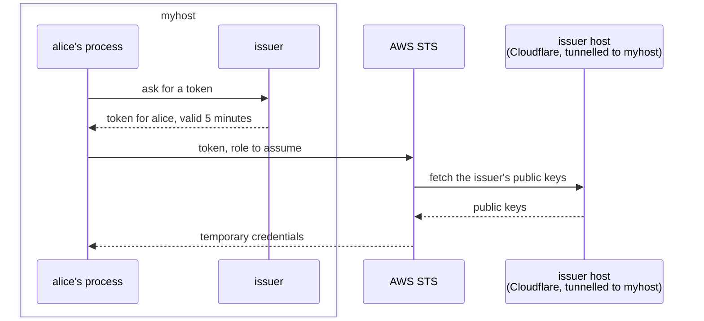
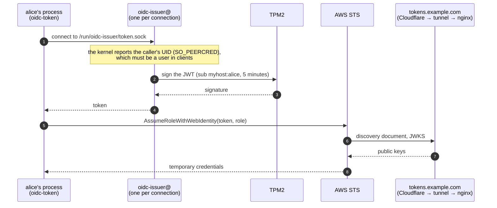
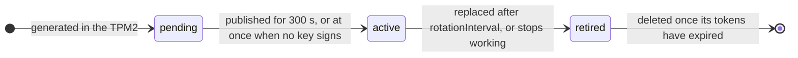
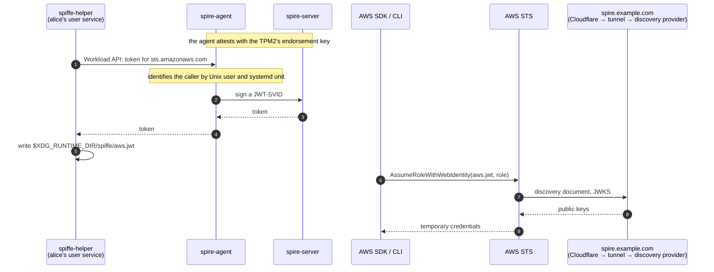

# oidc-issuer

Short-lived AWS credentials for the users and services of a NixOS machine, with
no long-lived keys on it. The machine runs its own OIDC issuer, and AWS trusts
its tokens the way it trusts GitHub Actions'.



## At a glance

- **What you get:** `aws sts get-caller-identity --profile myhost` works for
  `alice` on `myhost`, with credentials from a 5-minute token the machine
  signs for `alice`.
- **Two issuers**, deployable alone or side by side:

  |              | Simple                                         | SPIRE                                      |
  | ------------ | ---------------------------------------------- | ------------------------------------------ |
  | Identities   | Unix users                                     | Unix users and systemd units               |
  | Signing key  | in the TPM2, never leaves it                   | a file only the SPIRE server reads         |
  | Key rotation | automatic, weekly                              | automatic, weekly                          |
  | Moving parts | a socket-activated signer, a rotation timer, nginx | SPIRE server, agent and discovery provider |

- **Requirements:** NixOS 26.05 or later, a TPM 2.0 (with Secure Boot for the
  simple issuer), a domain on Cloudflare, an AWS account, OpenTofu or
  Terraform.
- **Setup:**
  1. Add the flake and its NixOS module.
  2. Create a Cloudflare tunnel and DNS names with `terraform/cloudflare`.
  3. Enable an issuer.
  4. Create the AWS providers and roles with `terraform/aws`.
  5. Point an AWS profile at it.

## Setup

The examples use `example.com`, a machine named `myhost`, a user `alice` and a
tunnel named `my-tunnel`. Run the Terraform steps in a clone of this
repository; each directory keeps its state in a local `terraform.tfstate`
unless you add a backend. `nix develop` gives you `tofu`, `cloudflared` and
`aws`.

### 1. Add the flake

```nix
{
  inputs.oidc-issuer = {
    url = "github:gshpychka/oidc-issuer";
    inputs.nixpkgs.follows = "nixpkgs";
  };
}
```

and add `inputs.oidc-issuer.nixosModules.default` to the machine's modules
(`nixosModules.simple` or `nixosModules.spire` for just one issuer).

### 2. Cloudflare tunnel and DNS

The API token needs Zone · Zone · Read and Zone · DNS · Edit on the zone, and
Account · Cloudflare Tunnel · Edit on its account. AWS fetches the issuer
hosts' documents unattended, so they need to answer without a bot challenge.

```sh
cd terraform/cloudflare
export TF_VAR_cloudflare_api_token=<API token>
tofu init
tofu apply \
  -var cloudflare_zone_id=<zone ID> \
  -var tunnel_name=my-tunnel \
  -var 'hostnames=["tokens.example.com","spire.example.com"]'
```

This creates the tunnel and a proxied CNAME for each issuer host. The tunnel's
secret stays out of the Terraform state; fetch it into a credentials file with
the origin certificate:

```sh
cloudflared tunnel login   # once; writes ~/.cloudflared/cert.pem
cloudflared tunnel token --cred-file creds.json my-tunnel
```

Put `creds.json` on the publishing machine as a secret and run the tunnel
there:

```nix
{
  # sops-nix shown; any secrets mechanism that yields a file works
  sops.secrets.cloudflare-tunnel = {
    sopsFile = ./secrets/cloudflare-tunnel.json;
    format = "json";
    key = ""; # the whole file
  };

  services.cloudflared = {
    enable = true;
    tunnels.my-tunnel = {
      credentialsFile = config.sops.secrets.cloudflare-tunnel.path;
      default = "http_status:404";
    };
  };
}
```

The issuers' `cloudflareTunnel` options add their routes to this tunnel.

### 3a. The simple issuer

```nix
{
  services.oidc-issuer.simple = {
    enable = true;
    host = "tokens.example.com";
    clients = [ "alice" ];
    cloudflareTunnel = "my-tunnel";
  };
}
```

Deploy. The machine generates its first key in the TPM2 and publishes it.
Check it:

```sh
curl https://tokens.example.com/.well-known/jwks.json
oidc-token claims   # as alice, in a login session that started after the deploy
```

### 3b. The SPIRE issuer

Read the TPM2's endorsement key hash:

```sh
sudo nix shell nixpkgs#spire-tpm-plugin -c get_tpm_pubhash
```

```nix
{
  services.oidc-issuer.spire = {
    enable = true;
    host = "spire.example.com";
    trustDomain = "example.com";
    tpmEkHash = "<printed hash>";
    users = [ "alice" ];
    # system services get their own identity, per unit
    services.backup.user = "backup";
    cloudflareTunnel = "my-tunnel";
  };
}
```

Deploy, then check it:

```sh
curl https://spire.example.com/keys
spire-agent api fetch jwt -audience sts.amazonaws.com   # as alice
```

spiffe-helper runs in each listed user's systemd instance, so it starts with
their first login session, or at boot with `users.users.<name>.linger = true`.

### 4. AWS

Describe each issuer and the roles its tokens may assume, one exact subject per
role, in `terraform/aws/issuers.auto.tfvars`:

```hcl
issuers = {
  simple = {
    host = "tokens.example.com"
    roles = {
      "myhost-alice" = {
        subject     = "myhost:alice"
        policy_arns = ["arn:aws:iam::aws:policy/ReadOnlyAccess"]
      }
    }
  }
  spire = {
    host = "spire.example.com"
    roles = {
      "myhost-alice-spire" = {
        subject = "spiffe://example.com/myhost/user/alice"
      }
    }
  }
}
```

```sh
cd terraform/aws
tofu init
tofu apply -var aws_account_id=<12-digit account ID>   # with your usual AWS credentials
```

The `role_arns` output has each role's ARN. A role without `policy_arns` can
still run `aws sts get-caller-identity`, which proves the whole chain.

### 5. Use it

As `alice`, in `~/.aws/config`. The simple issuer:

```ini
[profile myhost]
region = us-east-1
credential_process = oidc-token aws --role-arn arn:aws:iam::<account>:role/myhost-alice
```

The SPIRE issuer:

```ini
[profile myhost-spire]
region = us-east-1
role_arn = arn:aws:iam::<account>:role/myhost-alice-spire
web_identity_token_file = /run/user/<alice's uid>/spiffe/aws.jwt
```

```sh
aws sts get-caller-identity --profile myhost
```

AWS CLIs and SDKs get fresh credentials from either profile on their own.
`oidc-token` also prints a bare token (`oidc-token`) or its claims
(`oidc-token claims`), and `oidc-token aws --region <region>` uses that
region's STS endpoint.

## How it works

Each issuer has its own host, serving its discovery document and public keys
over HTTPS. The modules route that host through a Cloudflare tunnel that passes
only those document paths, so the machine accepts no inbound connections.

### Simple



- **Identity:** the caller sends nothing. The socket admits only the
  `oidc-token` group (the users in `clients`), and the signer checks the list
  again against the UID the kernel reports for the connection.
- **Signer:** systemd starts one sandboxed `oidc-issuer@` instance per
  connection, with the active key's files. It checks each signature against
  the key's public half before replying, and logs every issuance and refusal
  to the journal.
- **Keys:** ECDSA P-256 keys the TPM2 generated with `fixedtpm|fixedparent`,
  so they cannot leave that TPM2. On disk are only each key wrapped by the
  TPM2's storage key and its random auth value, sealed with `systemd-creds` to
  the TPM2 and the host key in `/var/lib/systemd`. The seal is bound to PCR 7,
  which records the Secure Boot state and keys, so it opens only under the
  machine's own Secure Boot chain.
- **Publisher:** nginx serves the discovery document and the JWKS on
  `127.0.0.1:81`.
- **Client:** `oidc-token aws --role-arn <ARN>` trades the token for
  credentials and prints them in `credential_process` format.

#### Key rotation

`oidc-issuer-rotate` runs at boot, on deploy and every 5 minutes. Each run
takes keys one step through their lifecycle and writes the JWKS from every key
that is not deleted:



- A new key is generated when the active one has signed for
  `rotationInterval` (a week by default), when a run finds no key that signs,
  or on `sudo oidc-issuer-rotate-now`.
- It stays pending for `jwksCacheSeconds` (300), so relying parties' cached
  key sets include it before it signs. With no key that signs, it activates at
  once.
- A key that stops working is retired on the next run and replaced: its sealed
  auth value no longer opens after a Secure Boot key or dbx update changes
  PCR 7, and clearing the TPM2 destroys it.
- A retired key stays published until the tokens it signed have expired, then
  it is deleted.
- Every run loads each key in the TPM2 and checks its attributes and public
  half: the JWKS lists only keys this TPM2 holds.

### SPIRE



- **Server:** `spire-server` listens on loopback only. It rotates its JWT
  signing keys itself and publishes each one days before signing with it.
- **Agent:** `spire-agent` proves to the server that it runs on this machine
  with the TPM2's endorsement key, and serves the Workload API on a Unix
  socket.
- **Entries:** `spire-entries` makes the server's registration entries match
  `users` and `services`, deleting any other entry.
- **Publisher:** SPIRE's `oidc-discovery-provider` serves the discovery
  document and live JWKS on a Unix socket.

## Trust model

- **Identity is per Unix user or systemd unit.** Every process running as a
  client user can get that user's token; with SPIRE, a unit in `services` has
  an identity of its own.
- **Root on the issuing machine can mint a token for any of its subjects**,
  through the TPM2 key (simple) or the SPIRE server's key, and so can anything
  that grants root: sudo rules, SSH agent forwarding, Nix `trusted-users`. The
  simple issuer's keys never leave the TPM2, so signing ends with access to
  the machine; a key's files and auth value together sign again with later
  access to that TPM2 until the key is retired.
- **AWS trusts whatever JWKS the issuer host serves.** Whoever controls the
  host's DNS record or the tunnel (the Cloudflare API token, the origin
  certificate, the tunnel credentials) controls which keys AWS accepts.
- **Each role trusts one exact subject.** The roles from `terraform/aws` match
  `aud` and `sub` with `StringEquals`.
- **Tokens live 5 minutes**, and STS accepts a token more than once until it
  expires.

## Layout

| Path                    | What it is                                                                              |
| ----------------------- | --------------------------------------------------------------------------------------- |
| `package/`              | `oidc-issuer` (signing and key rotation) and `oidc-token` (the client), in Python       |
| `modules/simple/`       | the simple issuer: `default.nix` (its options), `signer.nix`, `publisher.nix`           |
| `modules/spire.nix`     | the SPIRE issuer                                                                        |
| `terraform/cloudflare/` | the tunnel and the issuer hosts' DNS records                                            |
| `terraform/aws/`        | the IAM OIDC providers and the roles that trust them                                    |
